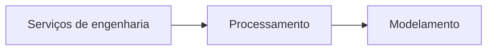

# Vena_IA — Visão geral

### Inteligência artificial aplicada à engenharia

A **Vena_IA** é uma plataforma em desenvolvimento para apoiar profissionais de engenharias, manufatura avançada e pesquisadores na organização de projetos, interpretação de informações técnicas e avaliação de resultados.

Sua proposta é aproximar conhecimento de engenharia e inteligência artificial em uma experiência visual, organizada e orientada à revisão profissional.

**Conheça a plataforma: [venaia.com.br](https://venaia.com.br/)**

## O que a Vena_IA faz

- **Organização de projetos:** reúne informações e documentos relacionados a cada trabalho de engenharia.
- **Apoio à análise técnica:** auxilia a interpretação de modelos e informações para análises preliminares.
- **Acompanhamento do processamento:** apresenta a evolução das etapas e os resultados disponíveis.
- **Visualização e revisão:** facilita a consulta de resultados e a avaliação técnica antes de seu aproveitamento.

**Projetos testados e validados no laboratório da Vena_IA.**

A plataforma está em evolução. As análises apoiam o trabalho do profissional e requerem revisão técnica; não representam aprovação automática para produção em geral.

## Arquitetura genérica

**Serviços de engenharia → Processamento → Modelamento**

| Etapa | Papel na proposta da plataforma |
| --- | --- |
| **Serviços de engenharia** | Organizar as necessidades do projeto e as informações técnicas relevantes. |
| **Processamento** | Analisar as informações recebidas e apoiar a elaboração de resultados preliminares. |
| **Modelamento** | Reunir representações e interpretações técnicas para visualização, avaliação e revisão profissional. |

Esse fluxo apresenta a visão conceitual do produto. O alcance do modelamento depende das funcionalidades disponíveis em cada etapa de desenvolvimento.

## O que já foi desenvolvido

- **Identidade e apresentação digital:** página de entrada com a marca Vena_IA, animação de partículas e interação por mouse e toque.
- **Experiência de acesso:** telas de cadastro e entrada, com apresentação adaptada a computador, celular e tablet.
- **Ambiente de projetos:** organização de trabalhos e envio de arquivos técnicos nos fluxos implementados.
- **Fluxos controlados de análise:** acompanhamento do processamento, visualização de resultados e revisão humana nos cenários disponíveis.
- **Validação de software:** testes automatizados de funcionalidades, navegação e apresentação em diferentes dimensões de tela.

Essas entregas compõem a base atual da plataforma. A cobertura técnica e a experiência de uso continuam sendo ampliadas e validadas.

## Testes e validações de engenharia

Os fluxos implementados são avaliados com arquivos e cenários controlados, incluindo entradas válidas, situações incompletas e condições que devem impedir a continuidade da análise.

- **Arquivos STEP:** testes de envio, leitura e processamento de modelos, com identificação de arquivos inválidos e verificação das informações geométricas nos casos suportados.
- **CAD e modelamento:** verificações de consistência geométrica, perfis e unidades, com indicação de condições que exigem revisão técnica.
- **CAM e planejamento:** testes de planejamento preliminar de usinagem nos cenários implementados, incluindo tratamento de informações ausentes e condições incompatíveis.
- **CNC e G-code:** testes de prévias e programas candidatos, formatação e coerência dos parâmetros nos cenários suportados. Os resultados permanecem sujeitos à revisão profissional.
- **Simulação e visualização:** verificações de representação de trajetórias, limites e avisos nos cenários de simulação disponíveis.
- **Fluxo de projetos:** testes de acompanhamento do processamento, consulta de resultados, revisão e download nos fluxos controlados.

Na bateria de software registrada em 8 de outubro de 2026, **1.379 testes foram aprovados**. Outros **9 testes não foram executados por requisitos de ambiente**. Esse total abrange diferentes áreas da plataforma, incluindo engenharia, acesso, navegação e operações.

Essas verificações demonstram o comportamento do software nos casos testados. A aprovação para produção em geral depende de revisão técnica e das validações físicas aplicáveis a cada projeto.

## Direção de evolução

A Vena_IA busca ampliar o apoio à análise, ao modelamento e ao planejamento de engenharia, com resultados mais claros e melhor integração entre as etapas de trabalho.

As próximas capacidades serão apresentadas conforme forem implementadas e validadas.

## Apresentação institucional

Este material apresenta a proposta e a evolução da Vena_IA em nível conceitual. A implementação técnica e os materiais internos do projeto permanecem privados.

**Vena_IA · Engenharia e Manufatura Avançada.**  
[Acesse o site](https://venaia.com.br/)
